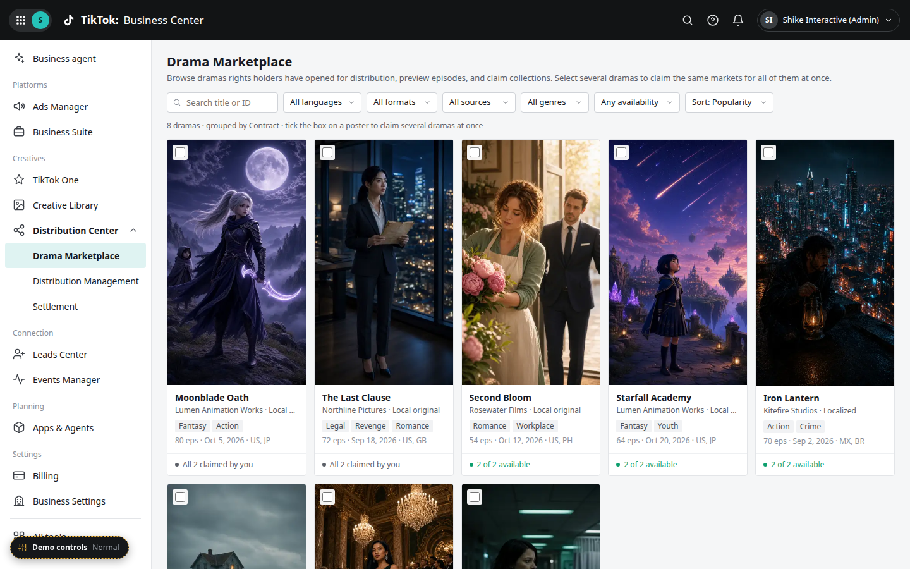
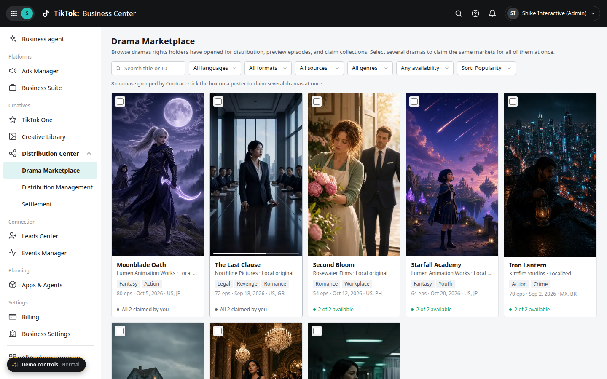
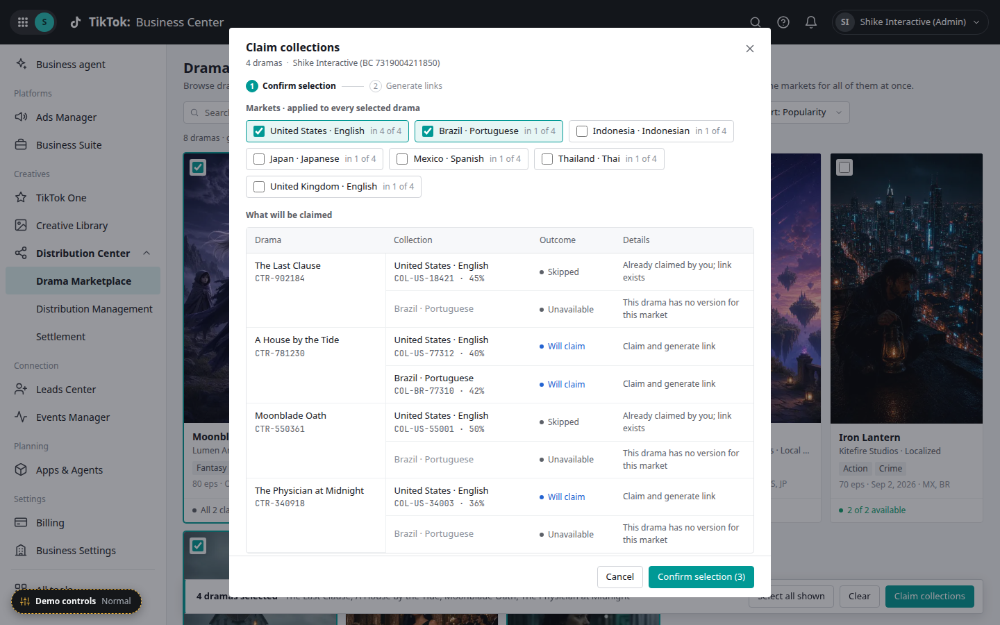
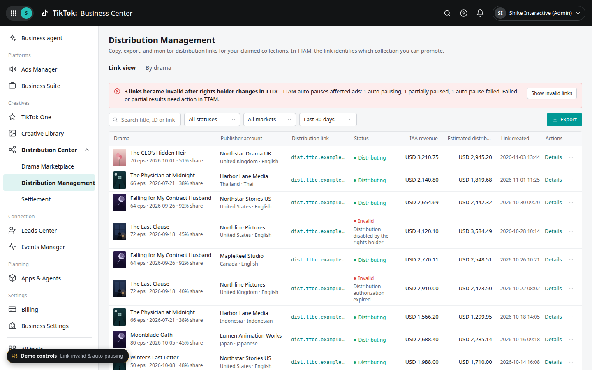
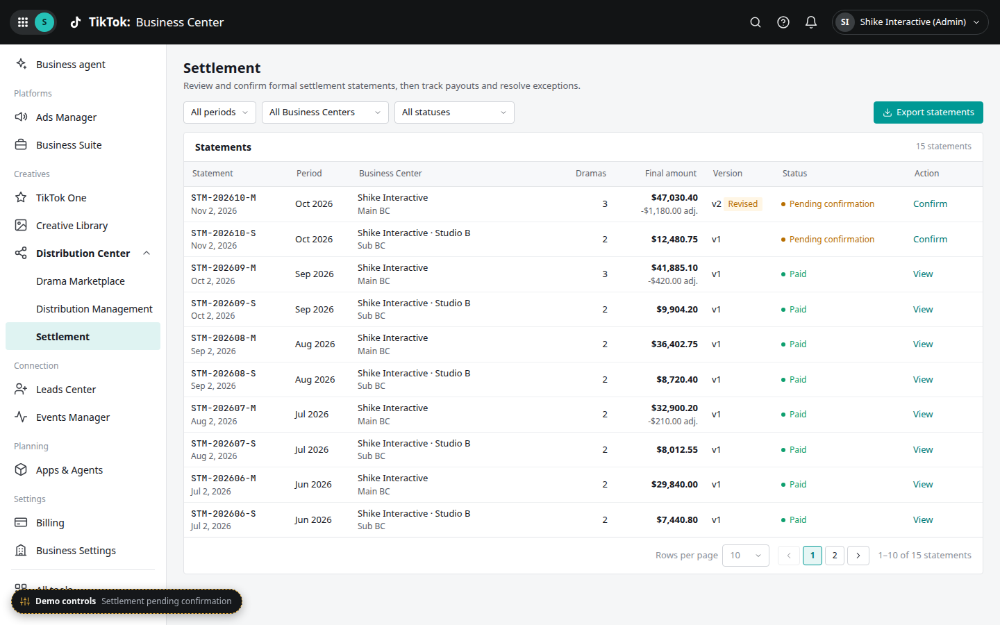

# Distribution Center — TTBC Short-Drama Distributor Workbench (Prototype)

An interactive HTML prototype (one `index.html` plus a folder of cover media) of a **short-drama distributor workbench** hosted inside TikTok Business Center (TTBC). Distributors browse dramas that rights holders have opened for distribution, claim collections, generate distribution links for use in TTAM, track link health (with auto-pause when a link becomes invalid), and review, confirm, and track payouts for settlement statements.

**Live demo:** https://lexy-xy.github.io/distribution-platform/

## What's inside

Three business modules, all under **Creatives → Distribution Center** in the left nav:

- **Drama Marketplace** — browse distributable dramas on cards with 9:16 portrait covers and claim collections, one drama at a time or in bulk: tick the checkbox on several drama cards, then **Claim collections** to claim across multiple contracts at once. Claiming is a two-step flow: **Confirm selection** (pick the collections to claim) → **Generate links** (distribution links are generated, with **Copy all** / **Export all** for use in TTAM).
- **Distribution Management** — link view and by-drama view; copy/export links, monitor link validity and auto-pause results.
- **Settlement** — settlement statements, confirmation, and payout logs.

A **floating demo controller** (bottom-left, dashed yellow outline — not part of the product UI) switches between **4 views × 9 states**:

- Views: Drama Marketplace · Link view · By drama · Settlement
- States: Normal · Empty · Loading · Error · Partial success · Result unknown · Link invalid & auto-pausing · Settlement pending confirmation · Payout exception

The controller also has a **Cover style** option for the Marketplace, which sets what a drama cover does on hover:

- **Clip** — plays a short (3–5 s) muted, looping video preview
- **Keyframes** — cycles through key stills with a progress bar
- **Static** — keeps the poster still
- **Mixed** (default) — cards rotate through all three styles

Each view/state combination is deep-linkable, e.g. `#/distribution/links?state=invalid` or `#/settlement?state=payout`, and the controller's **Copy demo link** button copies the current one.

## Screenshots











More in [`screenshots/`](screenshots/).

## Run locally

No build step or backend; plain HTML/CSS/JavaScript. Keep the `assets/` folder next to `index.html` — the Marketplace covers and hover clips load from `assets/` by relative path, so opening `index.html` on its own shows placeholder covers instead.

```bash
git clone https://github.com/lexy-xy/distribution-platform.git
cd distribution-platform
open index.html            # macOS (or just double-click the file)
# or serve it:
python3 -m http.server 8000   # then visit http://localhost:8000
```

## Repository layout

| Path | Contents |
| --- | --- |
| `index.html` | The full prototype |
| `assets/` | Cover keyframes (`.webp`) and hover clips (`.mp4`) used by the Marketplace |
| `docs/requirements-context.md` | Requirements analysis and generation context (Chinese) |
| `screenshots/` | Reference screenshots of key views and states |
